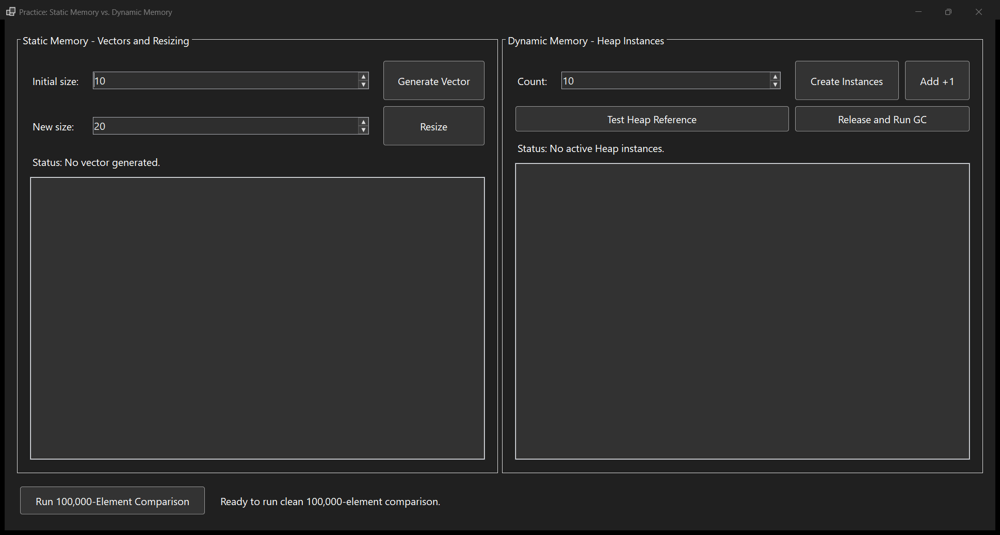
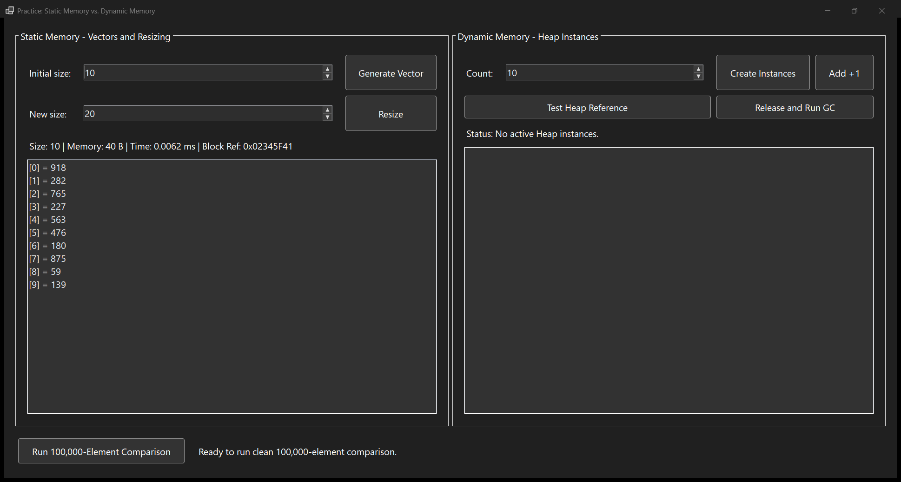
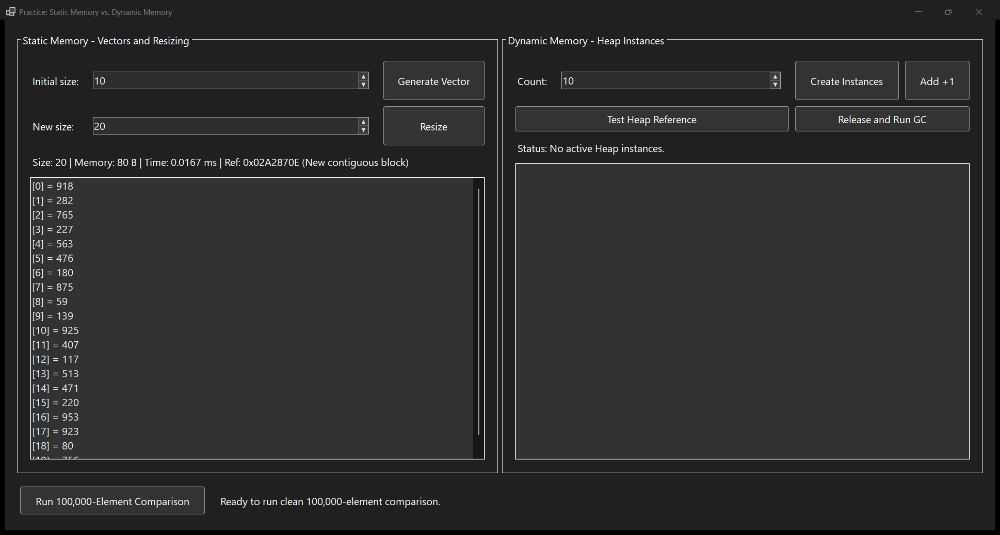
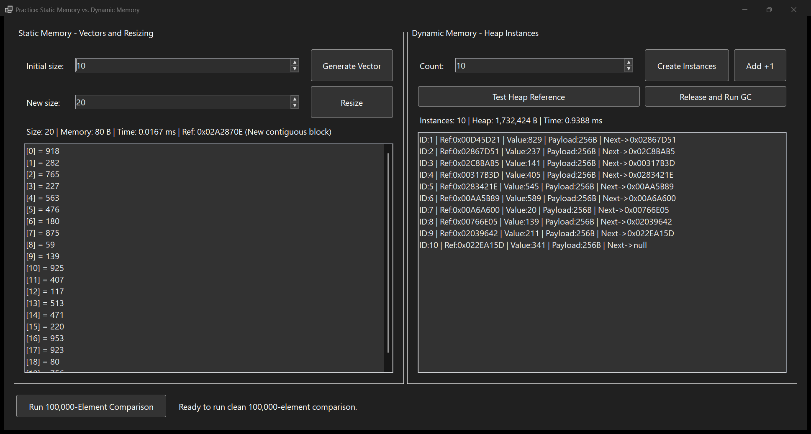
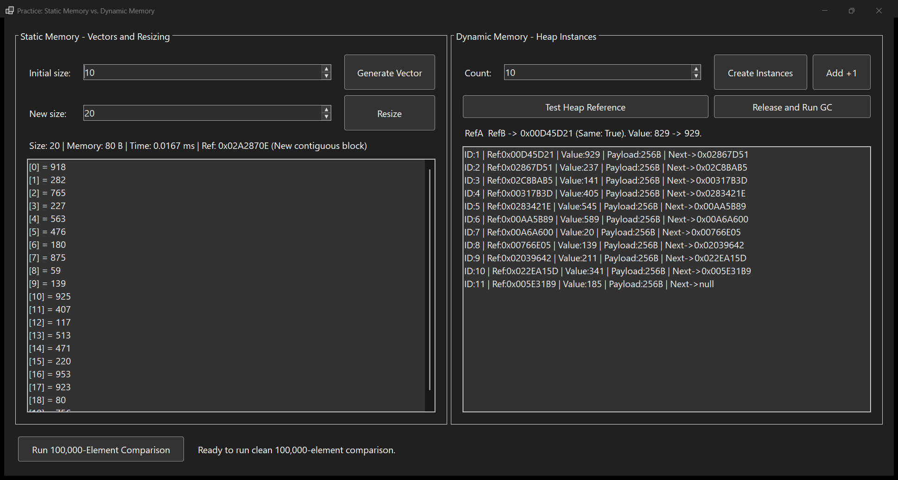
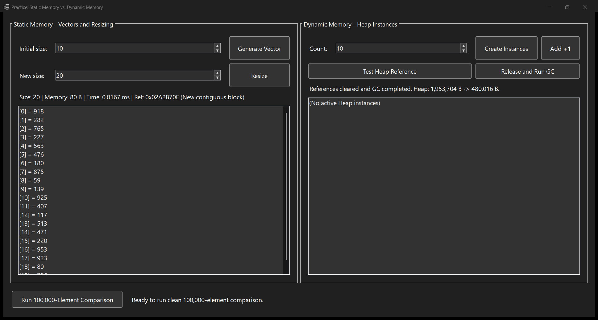
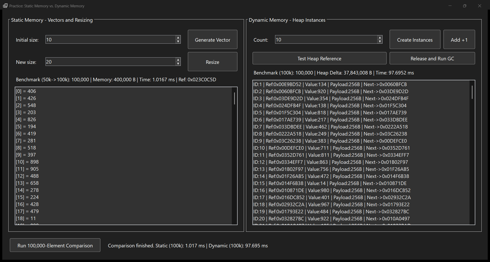

# Reporte de Ejecución y Casos de Prueba

**Proyecto:** Memoria Estática vs. Memoria Dinámica (`net10.0-windows`, Windows Forms)  
**Fecha de ejecución:** 20 de noviembre de 2026  
**Resultado general:** **7 / 7 casos de prueba aprobados**

---

## Resumen de resultados

| Caso | Prueba | Resultado | Métrica / Evidencia principal |
| :--- | :--- | :--- | :--- |
| **CP-01** | Estado inicial de la aplicación | Aprobado | Ambos paneles listos sin datos previos |
| **CP-02** | Generar vector estático (`10` elementos) | Aprobado | `40 B`, `0.0062 ms`, Ref `0x02345F41` |
| **CP-03** | Redimensionar vector estático (`10 -> 20`) | Aprobado | `80 B`, `0.0167 ms`, Ref `0x02A2870E` *(New contiguous block)* |
| **CP-04** | Crear instancias dinámicas en el Heap (`10` objetos) | Aprobado | `10` instancias, Heap `1,732,424 B`, `0.9388 ms` |
| **CP-05** | Agregar `+1` instancia y probar referencia compartida | Aprobado | `11` instancias; `RefA & RefB -> 0x00D45D21 (Same: True)`, `829 -> 929` |
| **CP-06** | Liberar referencias y ejecutar Garbage Collector | Aprobado | Heap liberado: `1,953,704 B -> 480,016 B` |
| **CP-07** | Benchmark comparativo (`100,000` elementos) | Aprobado | Estática: `1.017 ms` (`400,000 B`) vs. Dinámica: `97.695 ms` (`37,843,008 B`) |

---

## Detalle de los casos de prueba

### CP-01: Estado inicial de la aplicación
- **Objetivo:** Verificar que la ventana principal inicia maximizada, con ambos paneles limpios y controles habilitados.
- **Resultado observado:**
  - Memoria Estática: `Status: No vector generated.`
  - Memoria Dinámica: `Status: No active Heap instances.`
  - Benchmark: `Ready to run clean 100,000-element comparison.`

---

### CP-02: Generar vector estático (`10` elementos)
- **Objetivo:** Asignar un arreglo contiguo de 10 enteros y registrar su referencia y memoria estimada.
- **Acción:** Clic en **Generate Vector** con tamaño inicial `10`.
- **Resultado observado:** `Size: 10 | Memory: 40 B | Time: 0.0062 ms | Block Ref: 0x02345F41`

---

### CP-03: Redimensionar vector estático (`10 -> 20` elementos)
- **Objetivo:** Comprobar que `Array.Resize` asigna un nuevo bloque contiguo en memoria y copia los datos previos.
- **Acción:** Clic en **Resize** con nuevo tamaño `20`.
- **Resultado observado:** `Size: 20 | Memory: 80 B | Time: 0.0167 ms | Ref: 0x02A2870E (New contiguous block)`

---

### CP-04: Crear instancias dinámicas en el Heap (`10` objetos)
- **Objetivo:** Reservar 10 objetos `HeapObject` enlazados mediante referencias (`Next`) en el *Heap*.
- **Acción:** Clic en **Create Instances** con cantidad `10`.
- **Resultado observado:** `Instances: 10 | Heap: 1,732,424 B | Time: 0.9388 ms`

---

### CP-05: Agregar `+1` instancia y probar referencia compartida
- **Objetivo:** Verificar que agregar un nodo no reasigna los anteriores y que dos variables (`RefA` y `RefB`) apuntan a la misma instancia en el *Heap*.
- **Acción:** Clic en **Add +1** seguido de **Test Heap Reference**.
- **Resultado observado:**
  - Tras **Add +1**: `Instances: 11 | Heap: 1,830,856 B | Time: 0.0112 ms`
  - Tras **Test Heap Reference**: `RefA & RefB -> 0x00D45D21 (Same: True). Value: 829 -> 929.`

---

### CP-06: Liberar referencias y ejecutar Garbage Collector
- **Objetivo:** Limpiar las referencias raíz y forzar la recolección de basura para recuperar memoria del *Heap*.
- **Acción:** Clic en **Release and Run GC**.
- **Resultado observado:** `References cleared and GC completed. Heap: 1,953,704 B -> 480,016 B.`

---

### CP-07: Benchmark comparativo de `100,000` elementos
- **Objetivo:** Comparar el rendimiento entre memoria estática (`50,000 -> 100,000` enteros) y memoria dinámica (`100,000` objetos `HeapObject` con payload de `256 B`).
- **Acción:** Clic en **Run 100,000-Element Comparison**.
- **Resultado observado:**
  - Estática: `Benchmark (50k->100k): 100,000 | Memory: 400,000 B | Time: 1.0167 ms | Ref: 0x023C0C5D`
  - Dinámica: `Benchmark (100k): 100,000 | Heap Delta: 37,843,008 B | Time: 97.6952 ms`
  - Resumen: `Comparison finished. Static (100k): 1.017 ms | Dynamic (100k): 97.695 ms`

